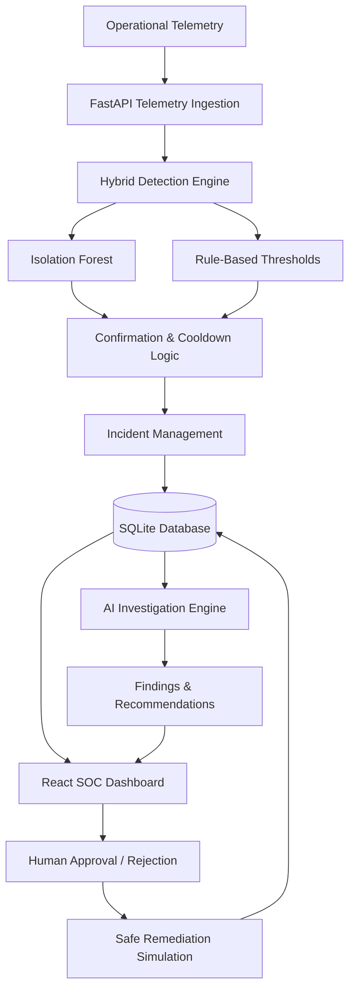
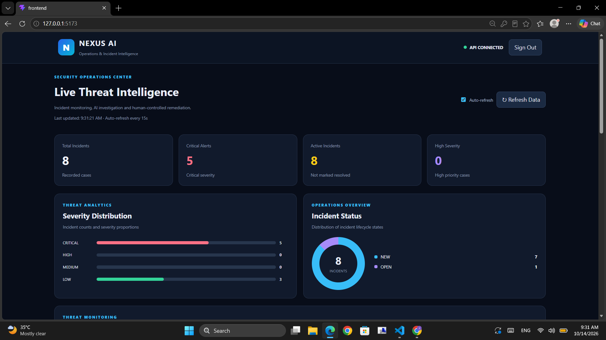
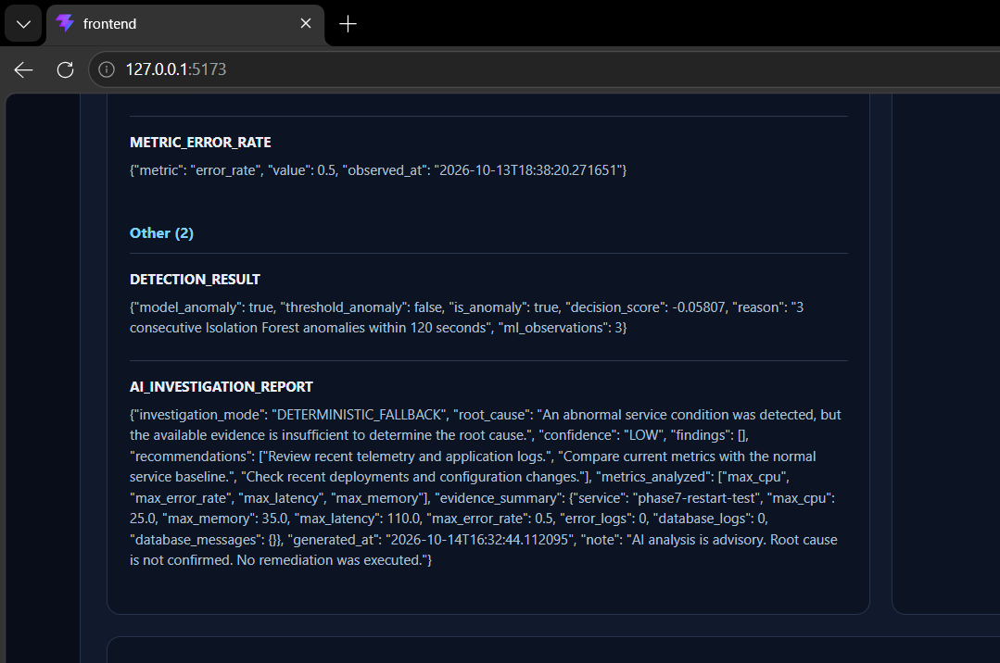
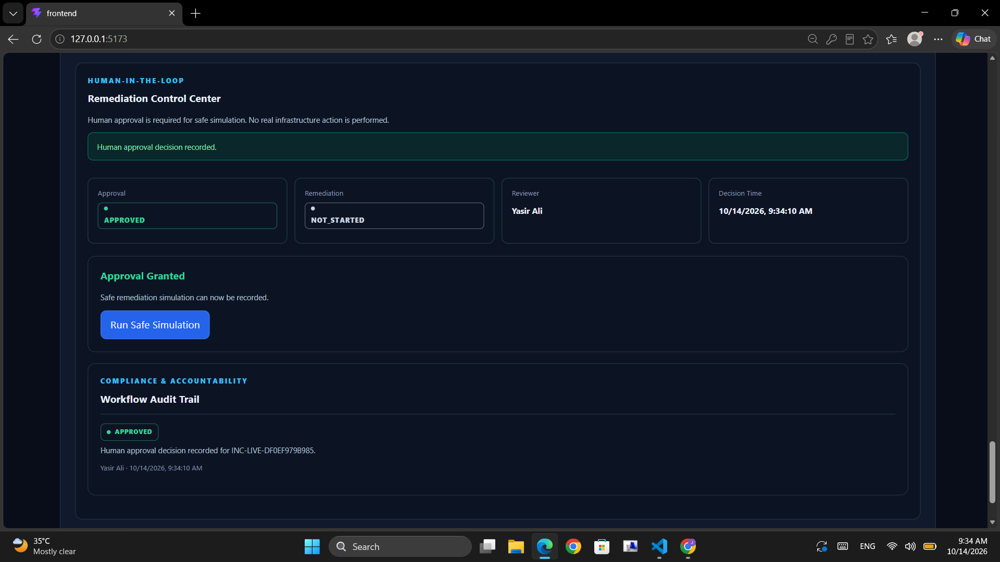
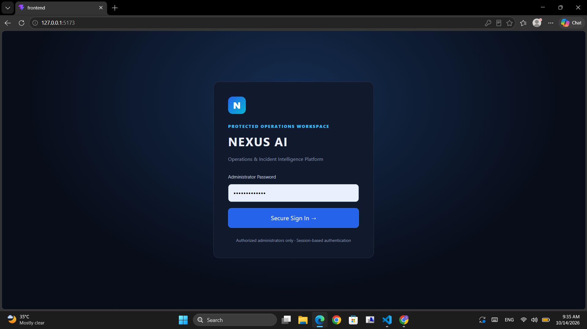

# 🛡️ NEXUS AI
### AI-Powered Operations & Incident Intelligence Platform

**An intelligent, human-controlled platform for anomaly detection, incident investigation, and safe remediation workflows.**

NEXUS AI combines machine learning, live telemetry monitoring, evidence-based incident analysis, and a security operations dashboard to support operational decision-making.

Rather than automatically changing infrastructure, the system keeps remediation under human control through an approval and simulation workflow.

---

## 🚀 Key Features

### 1. AI-Powered Anomaly Detection
- Isolation Forest-based anomaly detection
- Threshold-based detection of critical operational conditions
- Hybrid ML and rule-based detection approach
- Multiple-observation confirmation for ML-only anomalies
- Duplicate incident suppression through cooldown logic

### 2. Live Telemetry Monitoring
- REST API for ingesting operational metrics
- Monitoring of CPU usage, memory utilization, latency, request count, and error rate
- Persistent telemetry history using SQLite
- Automatic incident generation when detection criteria are met

### 3. Incident Intelligence
- Centralized incident records
- Severity classification
- Evidence collection and correlation
- Incident timeline tracking
- Root cause and confidence fields

### 4. AI Investigation Engine
- On-demand investigation of recorded incidents
- Evidence-based root cause assessment
- Key findings and response recommendations
- Persistent investigation reports
- Deterministic investigation mode without LLM API costs
- Optional LLM investigation support when configured

**AI-generated conclusions are advisory and do not automatically trigger remediation.**

### 5. Human-in-the-Loop Remediation
- Administrator-controlled approval and rejection
- Remediation simulation after approval
- Prevention of repeated approval or simulation actions
- Persistent audit trail for workflow decisions
- No real infrastructure modifications during simulation

### 6. Security Operations Dashboard
- React-based dark SOC-style interface
- Severity distribution visualization
- Incident queue with search and filters
- Recent incident activity
- Incident details, evidence, and timelines
- AI Investigation Center
- Human approval and remediation controls
- Automatic dashboard refresh

### 7. Authentication & Security
- Administrator login and logout
- Signed HttpOnly session cookies
- Protected incident and telemetry APIs
- Request-origin validation for state-changing operations
- Temporary login lockout after repeated failed attempts
- Automated authentication security tests

---

## 🏗️ System Architecture



The platform separates detection, investigation, and remediation decisions. This design allows operational anomalies to be investigated without immediately executing potentially disruptive actions.

---

## 🧰 Technology Stack

| Component | Technologies |
|---|---|
| Backend | Python, FastAPI, Pydantic |
| Frontend | React, Vite, JavaScript |
| Machine Learning | scikit-learn, Isolation Forest |
| Data Processing | Pandas, NumPy |
| Database | SQLite, SQLAlchemy |
| AI Investigation | Deterministic investigator, optional LLM integration |
| Authentication | Session middleware, HttpOnly cookies |
| Testing | Python unittest, FastAPI TestClient |
| CI | GitHub Actions |
| Version Control | Git, GitHub |

---

## 📁 Project Structure

```text
nexus-ai/
├── .github/
│   └── workflows/
│       └── ci.yml
├── ai/
├── backend/
│   └── app/
│       ├── api/
│       ├── core/
│       ├── models/
│       └── services/
├── config/
├── data/
│   └── synthetic/
├── frontend/
│   └── src/
├── ml/
├── scripts/
├── tests/
│   ├── test_api_integration.py
│   ├── test_api_smoke.py
│   └── test_auth_security.py
├── requirements.txt
├── .gitignore
└── README.md
```

Generated database files, credentials, virtual environments, and local backups are excluded from version control.

---

## ⚙️ Installation & Local Setup

### Prerequisites

- Python 3.10
- Node.js and npm
- Git

### 1. Clone the repository

```bash
git clone https://github.com/YasirAli-21/nexus-ai.git
cd nexus-ai
```

### 2. Create a Python virtual environment

**Windows PowerShell:**

```powershell
python -m venv .venv
.\.venv\Scripts\Activate.ps1
```

### 3. Install backend dependencies

```bash
python -m pip install -r requirements.txt
```

### 4. Configure authentication

Create a `.env` file in the repository root containing:

```dotenv
NEXUS_AUTH_ENABLED=true
NEXUS_ADMIN_PASSWORD=REPLACE_WITH_A_LONG_RANDOM_PASSWORD
NEXUS_SESSION_SECRET=REPLACE_WITH_A_LONG_RANDOM_SECRET
NEXUS_COOKIE_SECURE=false
```

The administrator password must be at least 12 characters, and the session secret must be at least 32 characters.

`NEXUS_COOKIE_SECURE=false` is intended only for local HTTP development. HTTPS deployments must use secure cookies.

Never commit `.env` or share actual passwords and API keys.

### 5. Start the FastAPI backend

From the project root:

```bash
python -m uvicorn backend.app.main:app --host 127.0.0.1 --port 8001
```

Backend health endpoint:

`http://127.0.0.1:8001/health`

### 6. Start the React frontend

Open another terminal:

```bash
cd frontend
npm ci
npm run dev
```

Open:

**http://127.0.0.1:5173**

Sign in using the administrator password configured in `.env`.

---

## 🔍 Example Workflow

1. Telemetry is submitted to the FastAPI ingestion endpoint.
2. The detection engine evaluates operational metrics using ML and threshold rules.
3. Anomalies meeting the configured detection criteria produce incident records.
4. Incident evidence and timeline events are stored.
5. An administrator opens the incident in the React dashboard.
6. The administrator runs an AI investigation and reviews findings.
7. The administrator approves or rejects the remediation proposal.
8. Approved cases may undergo a safe simulation.
9. Workflow decisions and results remain available in the audit trail.

**The current remediation workflow is simulation-only. It does not execute production infrastructure changes.**

---

## 🧪 Testing

The project includes automated integration and authentication tests.

Run backend integration tests:

```bash
python -m unittest discover -s tests -p "test_api_integration.py" -v
```

Run authentication security tests:

```bash
python -m unittest discover -s tests -p "test_auth_security.py" -v
```

Build the React frontend:

```bash
cd frontend
npm run build
```

The repository's GitHub Actions workflow runs these checks on pushes and pull requests targeting `main`.

The smoke-test suite is designed to validate a running application and is not included in the current CI pipeline.

---

## 🔐 Security Considerations

NEXUS AI currently provides security controls suitable for local development and portfolio demonstration.

Additional work is required before public or production deployment:

- HTTPS and secure cookie configuration
- Persistent, centralized login rate limiting
- Stronger session management and revocation
- Production authentication and access-control design
- Secret management and security monitoring
- Deployment-specific origin and proxy configuration
- Additional security and load testing

The present login limiter is process-local, and the remediation engine is intentionally restricted to simulation.

---

## 🗺️ Future Improvements

- Containerized deployment
- Expanded telemetry sources and integrations
- Advanced anomaly detection models
- Richer AI investigation and correlation
- Persistent security event monitoring
- Multi-user role-based access control
- Production-ready session and authentication infrastructure
- Improved reporting and incident analytics

---

## 👨‍💻 Author

**Yasir Ali**

Information Technology Graduate | AI/ML & Software Development

GitHub: [YasirAli-21](https://github.com/YasirAli-21)

---

## 📌 Project Status

**Portfolio MVP — Functional**

NEXUS AI currently includes operational anomaly detection, persistent incident intelligence, AI-assisted investigations, human-controlled remediation simulation, administrator authentication, automated testing, and a GitHub Actions CI pipeline.

The system remains a development and demonstration platform, not a production-ready autonomous remediation system.
## 📸 Platform Screenshots

### Security Operations Dashboard


### AI Investigation Center


### Human-Controlled Remediation


### Administrator Login


---
